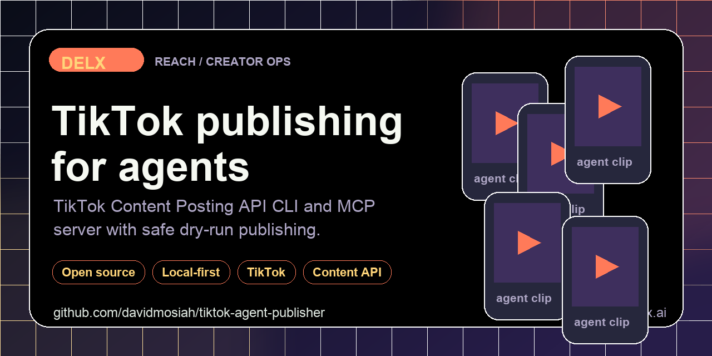

<!-- delx header v2 -->
<h1 align="center">TikTok Agent Publisher</h1>

<div align="center">
  
</div>

<h3 align="center">
  Agent-first TikTok Content Posting API CLI + MCP.<br>Dry-run safe, OAuth readiness checks, structured output for any agent runtime.
</h3>

<p align="center">
  <a href="https://www.npmjs.com/package/tiktok-agent-publisher"></a>
  <a href="https://www.npmjs.com/package/tiktok-agent-publisher"></a>
  <a href="LICENSE"></a>
  <a href="https://modelcontextprotocol.io"></a>
</p>

<p align="center">
  <a href="https://github.com/davidmosiah/tiktok-agent-publisher/stargazers"></a>
  <a href="https://github.com/davidmosiah/tiktok-agent-publisher/actions/workflows/ci.yml"></a>
  <a href="https://github.com/davidmosiah"></a>
  <a href="https://github.com/davidmosiah/tiktok-agent-publisher"></a>
</p>

> ⭐ **If this agent-first tool helps your workflow, please star the repo.** Stars make this tooling easier for other builders to discover and help Delx keep shipping open infrastructure.<br>
> 🧱 Part of the [Delx agent stack](https://github.com/davidmosiah) &mdash; 15 open-source MCP servers across **body, reach and coordination**.

---

<!-- /delx header v2 -->

Local-first TikTok Content Posting API tooling for AI agents. It gives Codex, Claude, Cursor, Hermes, OpenClaw and other MCP clients a safe way to check readiness, build OAuth URLs, dry-run publish flows and upload TikTok videos only when live mode is explicitly enabled.

Use it when an agent needs to publish or inspect TikTok content without browser automation, hidden state or token leakage.

## Why It Exists

Most social publishing scripts are built for humans at a terminal. Agents need a different contract:

- a manifest that explains install/runtime rules
- a connection status tool before write operations
- privacy boundaries that never return token values
- dry-run by default
- structured JSON outputs for planning, retries and audit trails

This repo packages that contract around TikTok's official Content Posting API.

## Install

```bash
npm install -g tiktok-agent-publisher
```

Or run without installing:

```bash
npm exec --yes --package=tiktok-agent-publisher -- tiktok-agent-publisher doctor
```

## First Post (Dry-Run) Walkthrough

No TikTok credentials are required to try this. With no `.env`, dry-run is on by
default, so every command below returns structured JSON without touching the live
API. This is the exact sequence an agent should follow before its first real post.
The outputs are real CLI runs, lightly trimmed.

**1. Check readiness.** `doctor` reports mode and what is still missing — never any
token values.

```bash
$ tiktok-agent-publisher doctor
{
  "ok": true,
  "dry_run": true,
  "configured": {
    "client_key": false,
    "client_secret": false,
    "access_token": false,
    "refresh_token": false,
    "public_media_base_url": false,
    "supabase_storage": false
  },
  "missing": [
    "TIKTOK_CLIENT_KEY",
    "TIKTOK_CLIENT_SECRET",
    "TIKTOK_ACCESS_TOKEN",
    "TIKTOK_REFRESH_TOKEN"
  ],
  "ready_for_live_publish": false,
  "ready_for_direct_video_upload": false,
  "next_steps": [
    "Current mode is dry-run. Use dry-run to validate agent workflow before live posting."
  ]
}
```

**2. Confirm the privacy boundaries.** `privacy-audit` states what stays local and
what is sent to TikTok, so the agent can reason about the contract before any write.

```bash
$ tiktok-agent-publisher privacy-audit
{
  "project": "tiktok-agent-publisher",
  "secrets_returned_to_agent": false,
  "token_storage": "Environment variables or local .env with user-only file permissions; tokens are never returned by tools.",
  "safety_rules": [
    "Dry-run is the default.",
    "Only post content the user owns or has permission to publish.",
    "Use explicit confirmation before live direct posting."
  ]
}
```

**3. Build the publish payload (dry-run).** This validates the job shape and caption
without uploading anything. `result.platformPostId` is a synthetic `dryrun_*` id and
`raw.dryRun` is `true`, so you can wire up retries and audit logging safely.

```bash
$ tiktok-agent-publisher publish-video \
    --video ./short.mp4 \
    --caption "First agent post — testing the dry-run flow" \
    --title "Hello from an agent"
{
  "ok": true,
  "dry_run": true,
  "job": {
    "id": "tiktok_1780082349025",
    "platform": "tiktok",
    "status": "queued",
    "caption": "First agent post — testing the dry-run flow",
    "mediaPaths": ["./short.mp4"],
    "metadata": { "title": "Hello from an agent" }
  },
  "result": {
    "provider": "tiktok_official",
    "platformPostId": "dryrun_1780082349025",
    "raw": { "dryRun": true, "jobId": "tiktok_1780082349025" }
  }
}
```

**4. Poll status (dry-run).** `publish-status` returns a `DRY_RUN` status so the
polling loop can be exercised end to end.

```bash
$ tiktok-agent-publisher publish-status --publish-id dryrun_1780082349025
{ "dryRun": true, "publishId": "dryrun_1780082349025", "status": "DRY_RUN" }
```

**5. List recent videos (dry-run).** Returns an empty, well-formed list — the same
shape the live API returns, so post-publish confirmation code works unchanged.

```bash
$ tiktok-agent-publisher list-videos --max-count 5
{ "dryRun": true, "videos": [], "cursor": null, "has_more": false }
```

**Going live.** Fill in `TIKTOK_CLIENT_KEY` / `TIKTOK_CLIENT_SECRET` (and complete
OAuth — see [`auth-url`](#cli)), confirm `doctor` reports `ready_for_live_publish: true`,
then set `TIKTOK_DRY_RUN=false`. The same five commands then operate against the real
Content Posting API.

## CLI

```bash
tiktok-agent-publisher manifest --client codex
tiktok-agent-publisher doctor
tiktok-agent-publisher privacy-audit
tiktok-agent-publisher auth-url --redirect-uri http://localhost:8787/callback
tiktok-agent-publisher publish-video --video ./short.mp4 --caption "Launch copy"
tiktok-agent-publisher publish-status --publish-id <publish_id>
tiktok-agent-publisher list-videos --max-count 10
```

Dry-run is enabled by default. Set `TIKTOK_DRY_RUN=false` only after `doctor` is clean and you are ready for live API calls.

## MCP

Stdio:

```bash
tiktok-agent-mcp
```

## HTTP (v2 stateless)

Default is **stdio**. Optional Streamable HTTP — no session id, JSON responses, loopback only:

```bash
npx -y -p tiktok-agent-publisher tiktok-agent-mcp --http
# GET  http://127.0.0.1:3031/health
# POST http://127.0.0.1:3031/mcp   (sessionless)
```

Env: `TIKTOK_MCP_HOST`, `TIKTOK_MCP_PORT`, `TIKTOK_MCP_TRANSPORT=http`.

Hermes-style config:

```yaml
mcp_servers:
  tiktok:
    command: npx
    args: ["-y", "tiktok-agent-publisher"]
    sampling:
      enabled: false
```

Recommended first calls:

1. `tiktok_connection_status`
2. `tiktok_privacy_audit`
3. `tiktok_publish_video`

## Agent Surfaces

| Tool | Purpose |
|---|---|
| `tiktok_agent_manifest` | Install/runtime guidance for Codex, Claude, Cursor, Hermes and OpenClaw |
| `tiktok_connection_status` | Dry-run, OAuth and media-hosting readiness without token values |
| `tiktok_privacy_audit` | Local file, token and live-publish boundaries |
| `tiktok_publish_video` | Dry-run or live video publish flow |
| `tiktok_publish_status` | Publish-status polling |
| `tiktok_list_videos` | Recent video list for post-publish checks |

## Copy-Paste Agent Prompt

```text
Use tiktok-agent-publisher. First call tiktok_connection_status and tiktok_privacy_audit.
If dry-run is enabled, build the publish payload only. Do not request or print token values.
```

## Configuration

Copy `.env.example` to `.env` and fill only the values you need. Do not commit `.env`, token files or `.agent-data/`.

For video inbox uploads, a local file can be uploaded directly through TikTok's upload URL. Photo and pull-from-url workflows can use Supabase Storage or another public media host.

## Safety Model

- Tokens are read from environment or local `.env`; tool responses never include token values.
- Live publishing is disabled unless `TIKTOK_DRY_RUN=false`.
- OAuth PKCE verifier is persisted locally in `.agent-data/` and not returned in MCP output.
- The package uses TikTok's official API surfaces; it does not automate a browser session.

## Development

```bash
npm install
npm test
npm run check
```

---

## 📧 Contact & Support

- 📨 **support@delx.ai** — general questions, integration help, partnerships
- 🐛 **Bug reports / feature requests** — [GitHub Issues](https://github.com/davidmosiah/tiktok-agent-publisher/issues)
- 🐦 **Updates** — [@delx369](https://x.com/delx369) on X
- 🌐 **Site** — [wellness.delx.ai](https://wellness.delx.ai)

